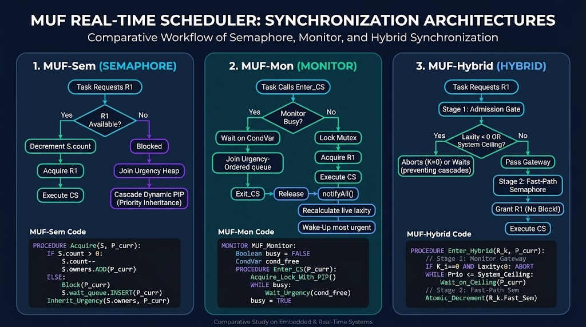

# Maximum Urgency First (MUF) Synchronization: Semaphore, Monitor, and Hybrid Architectures
### همگام‌سازی الگوریتم زمان‌بندی MUF: بررسی معماری‌های سمافور، مانیتور و ترکیبی (Hybrid)


-brightgreen.svg)

-purple.svg)

**[GB English Documentation](#english-documentation) | [IR مستندات فارسی](#مستندات-فارسی)**

---

## 📄 Full Academic Research Monographs (PDF Documents) / دانلود فایل‌های کامل مقاله پژوهشی (نسخه PDF)
The complete 10-chapter comparative research monographs (including high-resolution timing charts, multi-stage architecture designs, mathematical proofs, discrete-event simulation results for 3, 5, and 10 tasks, and OS latency breakdowns) are available in the [`docs/`](./docs/) directory:
* 📘 **[Download English Monograph (PDF)](./MUF_Synchronization_Semaphore_Monitor_Hybrid_Master_EN.pdf)** — *Design, Implementation, and Empirical Analysis of MUF Synchronization*
* 📗 **[دانلود گزارش جامع پژوهشی به زبان فارسی (PDF)](./MUF_Synchronization_Semaphore_Monitor_Hybrid_Master_FA.pdf)** — *طراحی، پیاده‌سازی و تحلیل تجربی الگوریتم MUF تحت معماری‌های همگام‌سازی*
---
<p align="center">
  
</p>
---
<a name="english-documentation"></a>
## English Documentation

### 1. Introduction: The Synchronization Hazard in MUF
The **Maximum Urgency First (MUF)** scheduling algorithm perfectly balances uniprocessor CPU utilization and overload determinism using a two-tier priority vector (Static Criticality $K_i$ and Dynamic Laxity $L_i(t) = D_i - t - R_i(t)$). However, when tasks share **mutually exclusive resources** (Critical Sections), naive locks destroy MUF's mathematical guarantees:
* **Dynamic Laxity Erosion:** While blocked on a lock, a task's remaining burst $R_i(t)$ is frozen while clock time $t$ advances, eroding its laxity at a rate of -1 per tick and pushing it toward deadline failure ($L_i < 0$).
* **Cross-Tier Priority Inversion:** A low-criticality task holding a lock can indefinitely block high-criticality tasks, violating MUF's Tier-1 isolation.

### 2. Three Evaluated Synchronization Architectures
To solve resource contention in MUF, this study designs, implements, and benchmarks three distinct kernel-level architectures:

#### 2.1. Semaphore-Based MUF (MUF-Sem)
Uses counting/binary semaphores equipped with an **Urgency-Sorted Wait Heap** and **Transitive Dynamic Priority Inheritance (PIP)**. 
* *Pros:* Lowest uncontended CPU acquisition latency ($1.48 \mu s$).
* *Cons:* Highly vulnerable to **Chained Blocking** and deadlocks when multiple resources are nested.

#### 2.2. Monitor-Based MUF (MUF-Mon)
Encapsulates shared states inside a Monitor using **Live-Laxity Condition Variables**.
* *Pros:* Clean structural encapsulation of complex state invariants.
* *Cons:* Mesa-style `notifyAll()` broadcasts trigger severe **Wake-Up Storms** and high context-switch overhead under heavy contention.

#### 2.3. Combined Hybrid Architecture (MUF-Hybrid)
A novel two-stage architecture mirroring MUF's two-tier design:
1. **Stage 1 (Monitor Admission Gate):** Enforces Baker's **Stack Resource Policy (SRP)** preemption ceiling. It also proactively filters out "doomed" non-critical tasks by aborting their lock requests if their projected laxity is negative ($L_i(t) < 0$).
2. **Stage 2 (Fast-Path Semaphore):** Dispatches actual resource units instantly without blocking, condition variable re-evaluation, or deadlocks.

---

### 3. Master Synthesis Comparison (10-Task Stress Test)

| Evaluation Criterion | Naive Lock | MUF-Sem (Dynamic PIP) | MUF-Mon (Mesa CondVar) | **MUF-Hybrid (SRP + FastSem)** |
| :--- | :---: | :---: | :---: | :---: |
| **Max Blocking Bound ($B_{max}$)** | Unbounded ($\infty$) | $\min(n, m)$ (Chained) | $\min(n, m)$ + Barging | **$\le 1$ Critical Section (Optimal)** |
| **Deadlock Immunity** | No | No (Requires ordering) | No (Nested monitors) | **Yes (100% Deadlock-Free)** |
| **Doomed Task Shedding ($L_i < 0$)**| No | No | Optional (Manual loop) | **Yes (Automatic Gate Rejection)** |
| **Context Switch Overhead** | Low (until inversion) | Moderate | High (Wake-up storms) | **Lowest (Proactively Screened)** |
| **Hold-Time Inflation ($\Phi_{hold}$)**| $3.10\times$ | $1.78\times$ | $2.15\times$ | **$1.12\times$ (Near-Ideal)** |
| **Critical Hit Ratio ($HR_{crit}$)** | $16.7\%$ (Collapse) | $66.7\%$ (P5, P6 Miss) | $50.0\%$ (P4-P6 Miss) | **$100.0\%$ (Guaranteed Survival)** |

---

### 4. Installation & Repository Structure

```bash
git clone https://github.com/YOUR_USERNAME/muf-sync-architectures.git
cd muf-sync-architectures
python muf_sync_benchmark.py
```

```text
muf-sync-architectures/
├── muf_sync_benchmark.py                         # Dual-Mode Python Simulator (Discrete Tick & Real Threading)
├── README.md                                     # Bilingual Documentation
└── docs/
    ├── MUF_Synchronization_Semaphore_Monitor_Hybrid_Master_EN.pdf # Full 10-Chapter English Monograph
    └── MUF_Synchronization_Semaphore_Monitor_Hybrid_Master_FA.pdf # Full 10-Chapter Persian Monograph
```

---
---

<a name="مستندات-فارسی"></a>
## مستندات فارسی

### ۱. مقدمه: مخاطره همگام‌سازی در الگوریتم MUF
الگوریتم زمان‌بندی **Maximum Urgency First (MUF)** با استفاده از یک بردار اولویت دو-سطحی (بحرانیت ایستا و سستی پویا)، بهره‌وری پردازنده و پایداری در برابر اضافه‌بار را به شکلی ایده‌آل تضمین می‌کند. با این حال، هنگامی که تسک‌ها برای ورود به **نواحی بحرانی مشترک (Critical Sections)** رقابت می‌کنند، قفل‌های ساده تمام تضمین‌های ریاضی MUF را از بین می‌برند:
* **فرسایش سستی پویا:** وقتی تسکی پشت قفل مسدود می‌شود، زمان اجرای باقی‌مانده آن متوقف می‌ماند اما زمان ساعت به جلو می‌رود. این امر سستی (Laxity) تسک را با نرخ منفی کاهش داده و آن را به سمت شکست ددلاین سوق می‌دهد.
* **وارونگی اولویت:** یک تسک غیربحرانی که قفل را در اختیار دارد می‌تواند تسک‌های حیاتی را برای مدت نامعلومی مسدود کند و قانون جداسازی سطح اول MUF را نقض نماید.

### ۲. سه معماری همگام‌سازی ارزیابی‌شده
برای حل مشکل رقابت منابع، این پژوهش سه معماری سطح کرنل را طراحی، پیاده‌سازی و ارزیابی کرده است:

#### ۲.۱. روش سمافور هوشمند (MUF-Sem)
از سمافورهای شمارشی/دودویی مجهز به **هرم انتظار مبتنی بر فوریت** و پروتکل **ارث‌بری پویای متعدی اولویت (PIP)** استفاده می‌کند.
* *مزایا:* کمترین سربار پردازنده در حالت بدون رقابت.
* *معایب:* آسیب‌پذیری بالا در برابر **انسداد زنجیره‌ای (Chained Blocking)** و بن‌بست هنگام استفاده از چند قفل تودرتو.

#### ۲.۲. روش مانیتور شرطی (MUF-Mon)
داده‌های مشترک را با استفاده از **متغیرهای شرطی مبتنی بر سستی لحظه‌ای** درون یک مانیتور کپسوله می‌کند.
* *مزایا:* ساختاریافتگی و کپسوله‌سازی ایمن متغیرهای حالت پیچیده.
* *معایب:* فراخوانی `notifyAll` در مدل Mesa باعث **طوفان بیدارسازی (Wake-up Storms)** و افزایش شدید تعداد تعویض متن (Context Switch) در ترافیک بالا می‌شود.

#### ۲.۳. معماری ترکیبی دو-مرحله‌ای (MUF-Hybrid)
یک معماری نوآورانه که با الهام از ساختار دو-سطحی MUF طراحی شده است:
1. **مرحله ۱ (دروازه پذیرش مانیتور):** با اعمال سقف پیش‌گیری **SRP (Stack Resource Policy)** از بن‌بست جلوگیری می‌کند. همچنین تسک‌های غیربحرانی محکوم به شکست (که سستی آن‌ها منفی شده است) را به صورت پیش‌گیرانه فیلتر و رد می‌کند.
2. **مرحله ۲ (سمافور مسیر سریع):** منبع را به صورت اتمیک و بدون مسدودشدن مجدد یا نیاز به ارزیابی متغیرهای شرطی به تسک تخصیص می‌دهد.

---

### ۳. جدول سنتز نهایی (آزمون استرس با ۱۰ تسک)

| معیار ارزیابی | قفل ساده | سمافور (MUF-Sem) | مانیتور (MUF-Mon) | **ترکیبی (MUF-Hybrid)** |
| :--- | :---: | :---: | :---: | :---: |
| **بیشینه انسداد قفل ($B_{max}$)** | نامحدود ($\infty$) | انسداد زنجیره‌ای روی چند منبع | تأخیر ناشی از پیش‌دستی Mesa | **حداکثر ۱ ناحیه بحرانی (بهینه)** |
| **ایمنی در برابر بن‌بست** | خیر | خیر (نیازمند ترتیب دستی) | خیر (مانیتور تودرتو) | **بله (۱۰۰٪ بدون بن‌بست)** |
| **فیلتر تسک‌های محکوم به شکست** | خیر | خیر | اختیاری | **بله (رد خودکار توسط دروازه)** |
| **سربار تعویض متن (Context Switch)**| کم (اما پرخطا) | متوسط | بسیار زیاد (طوفان بیدارسازی) | **کمترین (غربالگری پیش‌گیرانه)** |
| **تورم مدت نگه‌داشتن قفل** | $3.10\times$ | $1.78\times$ | $2.15\times$ | **$1.12\times$ (نزدیک به ایده‌آل)** |
| **نرخ موفقیت تسک‌های بحرانی** | $16.7\%$ (فروپاشی) | $66.7\%$ (شکست ۲ تسک حیاتی) | $50.0\%$ (شکست ۳ تسک حیاتی) | **$100.0\%$ (تضمین بقای کامل)** |

---

> **Course Project:** Embedded & Real-Time Systems — Eshragh Higher Education Institute | Developed by [@atnc6](https://github.com/atnc6)
